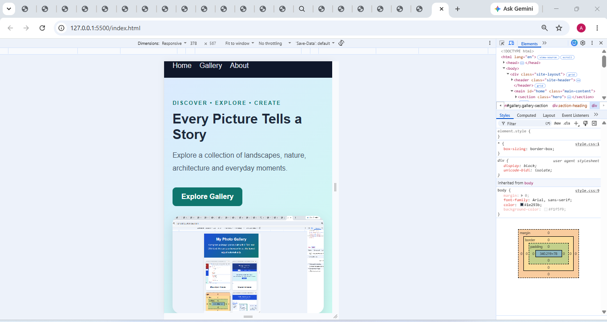

# Assignment 8.5 — CSS Grid Mini-Project

Project: Responsive Photo Gallery Website

Aim: To build a complete photo-gallery website using CSS Grid, including a header, navigation, featured section, image cards, consistent gaps, responsive columns, and a footer.

## 1. CSS Grid concepts demonstrated

| Requirement               | Implementation                                        |
| ------------------------- | ----------------------------------------------------- |
| Header, main and footer   | `grid-template-areas`                                 |
| Responsive columns        | `repeat(auto-fit, minmax(..., 1fr))`                  |
| Flexible sizing           | `fr` units                                            |
| Explicit grid placement   | `grid-column: span 2`                                 |
| Consistent spacing        | `gap: 24px`                                           |
| Image overflow prevention | `width: 100%`, `max-width: 100%`, `object-fit: cover` |
| Text overflow prevention  | `overflow-wrap: anywhere`                             |
| Mobile responsiveness     | Media queries at 800px and 560px                      |

## 2. Screenshots and submission checklist

Desktop screenshot

Mobile screenshot

## Github Repository
https://github.com/kimberly026/Assignment-8.5/edit/main/ASSIGNMENT8.5/SOLUTION.MD

